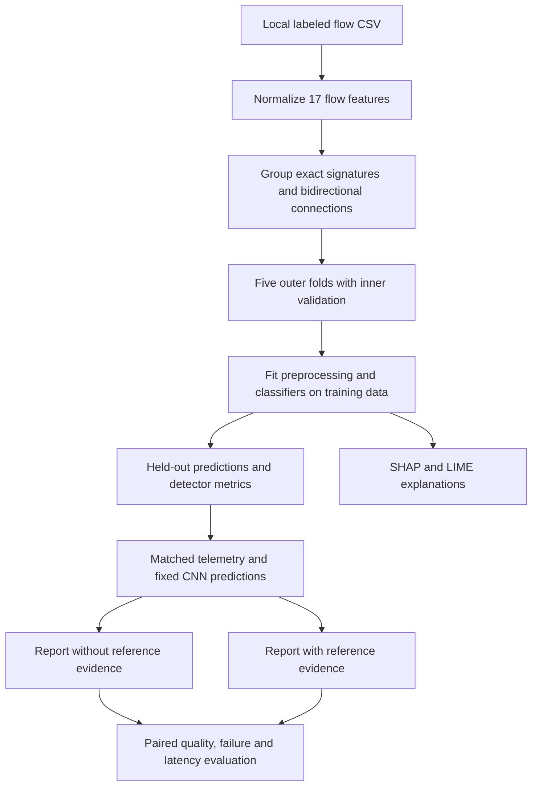

# Architecture and source map

## Research workflow

The final Transformer inference candidate is selected by validation loss and
refitted separately on all records. The paired RAG study uses fixed CNN
out-of-fold predictions, not predictions from that full-data refit. RAG supports
triage explanation; it does not retrain or change the classifier in this study.

## Where to work

| Location | Responsibility |
|---|---|
| [project.py](../project.py) | Windows virtual-environment command launcher |
| [Experiment source index](../src/experiments/README.md) | Partitioning, models, explanations, statistics, controlled RAG and inference |
| [rag/](../rag/README.md) | Retrieval, triage, local evidence corpus and earlier demonstrations |
| [tests/](../tests/) | Offline regression checks |
| [results/](../results/README.md) | Published summaries and local experiment outputs |
| [docs/](README.md) | Research documentation and current execution instructions |
| `dataset/` | Ignored local CSV and derived partitions |
| `archive/` | Ignored historical source and backup material |

Keep completed run directories stable: saved manifests, fingerprints and earlier
reports can refer to these paths. Use new run directories for new experiments.
